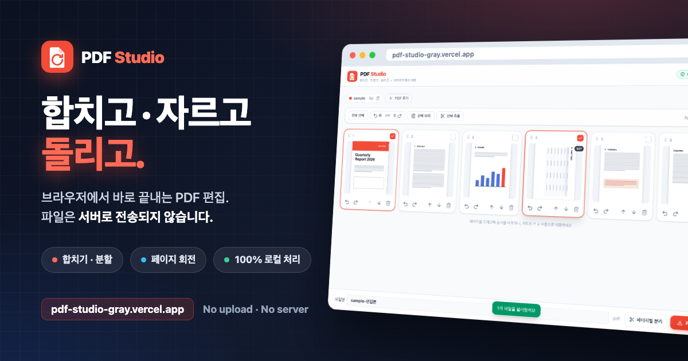
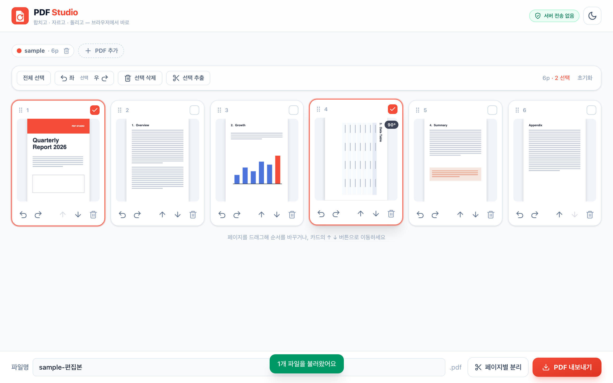

# PDF Studio

> 합치고 · 자르고 · 돌리고 — **브라우저에서 바로 끝내는 PDF 편집 툴**

PDF를 올려서 페이지 미리보기를 보고 **합치기 · 분할 · 순서 변경 · 회전(방향전환) · 삭제**까지 한 뒤 다시 다운로드하세요.
모든 처리가 **100% 브라우저 안에서** 일어나기 때문에 파일이 서버로 전송되지 않습니다. 개인정보가 담긴 문서도 안심하고 편집할 수 있어요.


## 🔗 라이브 데모

**https://pdf-studio-gray.vercel.app**

## ✨ 주요 기능

- 📤 **업로드** — 드래그&드롭 또는 파일 선택. 여러 PDF를 한 번에 올려도 돼요.
- 🖼️ **페이지 썸네일 그리드** — 모든 페이지를 pdf.js로 렌더링해 미리보기. 큰 파일도 비동기로 점진적 렌더링하며 진행률을 표시해요.
- 🔄 **페이지 회전(방향전환)** — 개별 페이지 90° 좌/우 회전, 전체 회전. **기존 `/Rotate` 값에 누적 적용**해서 이미 회전된 PDF도 어긋나지 않아요.
- ↕️ **순서 변경** — 드래그로 재정렬, 터치 환경을 위한 **↑ ↓ 이동 버튼**도 제공.
- 🔀 **합치기(Merge)** — 여러 PDF의 페이지를 하나로. 소스별 컬러 배지로 구분돼요.
- ✂️ **분할 · 추출(Split)** — 원하는 페이지만 골라 추출, 또는 **페이지별로 전부 분리해 ZIP으로** 저장.
- 🗑️ **페이지 삭제** — 필요 없는 페이지 제거.
- 💾 **내보내기** — 파일명을 지정하고 버튼을 눌러야 저장돼요(자동 다운로드 없음).
- 🔒 **100% 로컬 처리** — 파일이 서버로 올라가지 않아요. 암호가 걸린/손상된 PDF는 크래시 없이 안내 메시지로 처리.
- 🌗 **라이트 / 다크 테마** + 모바일(폭 ~390px) 대응 반응형.

## 🛠️ 기술 스택

| 영역 | 사용 기술 |
| --- | --- |
| 프레임워크 | React 19 + TypeScript |
| 번들러 | Vite |
| 스타일 | Tailwind CSS v4 (`@tailwindcss/vite`) |
| PDF 조작 | [`pdf-lib`](https://pdf-lib.js.org/) (merge / copyPages / setRotation / save) |
| PDF 렌더링 | [`pdf.js`](https://mozilla.github.io/pdf.js/) (`pdfjs-dist`, Vite `?url` 워커 번들링) |
| 분리 압축 | `jszip` (페이지별 분리 → 단일 ZIP 다운로드) |

> 서버/API 키 의존이 전혀 없습니다. 모든 PDF 처리는 사용자의 브라우저 안에서만 수행됩니다.

## 🔁 회전 누적 로직

PDF의 페이지 회전은 `/Rotate` 엔트리로 저장됩니다. 이미 90° 회전된 페이지를 다시 돌릴 때 값이 리셋되지 않도록,
**현재 절대 회전값에 델타를 더해 360° 모듈로로 정규화**합니다.

```ts
const normalize = (a: number) => ((Math.round(a / 90) * 90) % 360 + 360) % 360;
const rotate = (current: number, delta: number) => normalize(current + delta);
// 내보낼 때: copiedPage.setRotation(degrees(normalize(rotation)))
```

내보낸 PDF를 다시 `pdf-lib`로 재파싱해 **페이지 수 · 순서 · 각 페이지의 회전 각도**가 의도대로인지,
그리고 `pdf.js`로 **재렌더**까지 되는지 자동 검증했습니다. (사전 회전 90° 페이지를 +90° 돌려 180°가 되는 누적 케이스 포함)

## 🚀 로컬 실행

```bash
npm install
npm run dev     # http://localhost:5173
npm run build   # 프로덕션 빌드
npm run preview # 빌드 결과 미리보기
```

## 📸 스크린샷



---

<sub>모든 처리는 브라우저에서. 파일은 어디로도 전송되지 않습니다.</sub>
